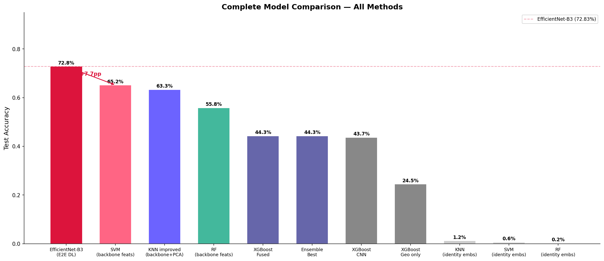
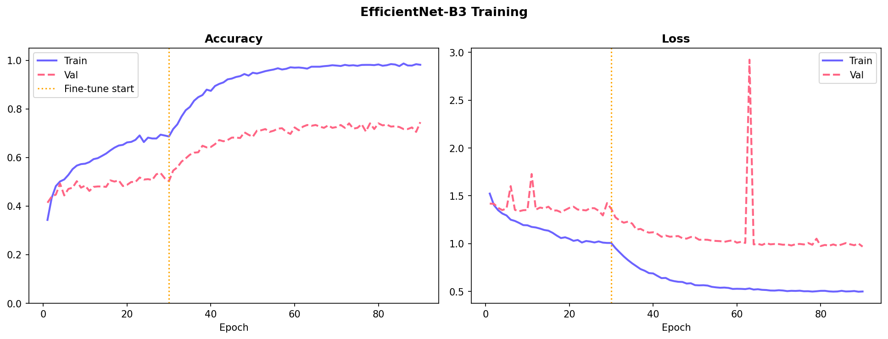
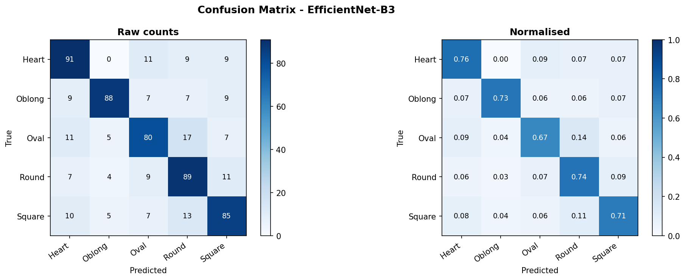
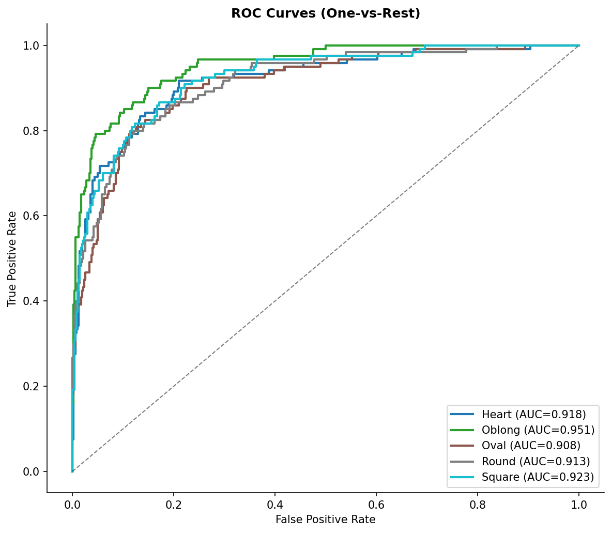
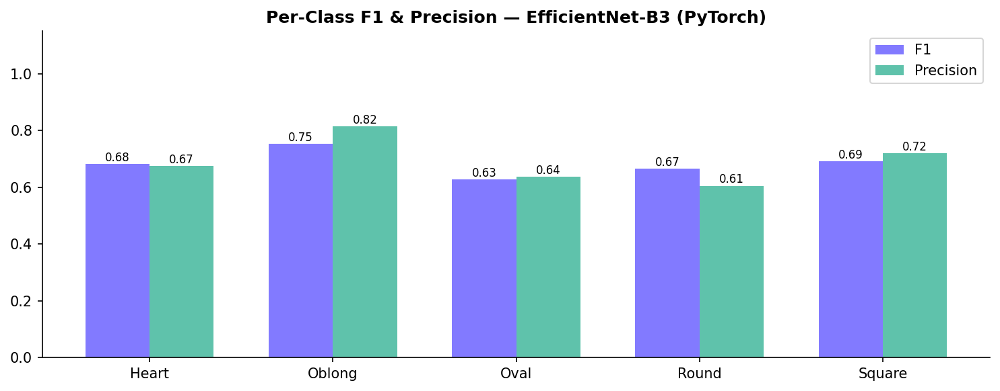
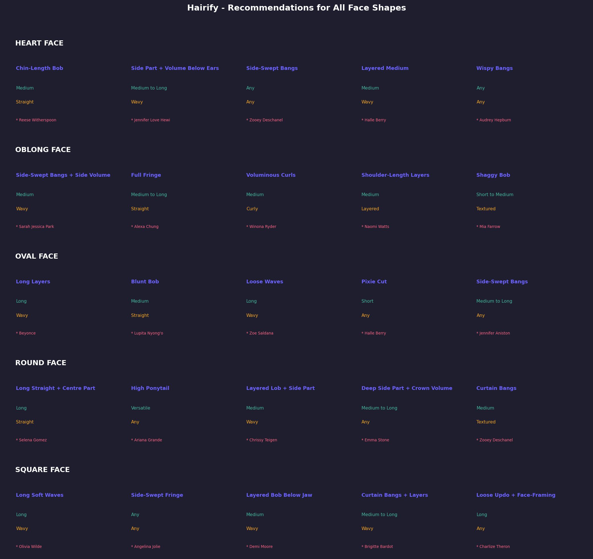

# Hairify: AI Hairstyle Recommendation & Virtual Try-On

> Graduation project, BSc Computer Science (Artificial Intelligence), The British University in Egypt, 2026.

Hairify classifies a person's **face shape** from a photo and recommends hairstyles that suit it. It also shows a rough visual preview. Each recommendation is grounded in a fine-tuned deep-learning classifier and a curated styling knowledge base.



## Results

Evaluated on a **balanced held-out test set of 600 images** (120 per class):

| Metric | EfficientNet-B3 (fine-tuned) |
|---|---|
| Accuracy | **72.8%** |
| Weighted F1 | **0.729** |
| Macro ROC-AUC | **0.920** |
| Best classical baseline (SVM on backbone features) | 65.2% (−7.7 pp) |

| Class | Precision | Recall | F1 |
|---|---|---|---|
| Heart | 0.71 | 0.79 | 0.75 |
| Oblong | 0.79 | 0.72 | 0.75 |
| Oval | 0.67 | 0.72 | 0.70 |
| Round | 0.70 | 0.73 | 0.72 |
| Square | 0.78 | 0.68 | 0.72 |

<p align="center">
  
  
</p>
<p align="center">
  
  
</p>

## How it works

```
photo ─► face detection & alignment ─► EfficientNet-B3 classifier ─► face shape (5 classes)
         (RetinaFace, Haar fallback)                                   │
                                                                       ▼
                       virtual try-on ◄── recommendation engine (25+ styles, "avoid" list)
                (HSV hair segmentation + alpha blend)
```

1. **Detection & alignment.** RetinaFace with 5-point landmarks, falling back to an OpenCV Haar cascade. Faces are cropped and resized to 224×224.
2. **Classification.** An ImageNet-pretrained **EfficientNet-B3** (`timm`) with a custom head: `1536 → 512 → BN → ReLU → Dropout(0.4) → 256 → ReLU → Dropout(0.2) → 5`.
3. **Two-phase transfer learning.**
   - *Phase 1:* the backbone is frozen and only the head is trained (30 epochs, lr 1e-3).
   - *Phase 2:* the top 5 EfficientNet blocks are unfrozen and fine-tuned (up to 60 epochs, lr 3e-5).
   - Both phases use AdamW, cosine annealing, label smoothing 0.1 and class-weighted cross-entropy.
4. **Hyperparameter search.** Optuna TPE, 12 trials.
5. **Recommendation engine.** A knowledge base mapping each face shape to ranked styles (length, texture, reasoning, example) and styles to avoid.
6. **Virtual try-on.** HSV-based hair segmentation with an alpha-composited colour overlay.
7. **Explainability.** Grad-CAM heat-maps, t-SNE of embeddings, ROC curves and a confusion matrix.

### Baselines compared
KNN, SVM and Random Forest on (a) face-identity embeddings and (b) 1536-d EfficientNet backbone features, plus XGBoost on CNN, geometric and fused features and a stacking ensemble. The end-to-end fine-tuned network beat all of them. Identity embeddings scored near chance, which confirmed that they carry no face-shape information.



## Dataset
- **Face Shape Dataset** (Kaggle): 4,000 images, 800 per class (Heart, Oblong, Oval, Round, Square). Stratified 70/15/15 split with seed 42 (2,787 / 597 / 600).
- **CelebA** (a subset) was used for the celebrity-similarity experiment.

Datasets are **not included**. Download them yourself, respect their licences, and point the paths in the first config cell to:
```
data/face_shape/training_set/<Heart|Oblong|Oval|Round|Square>/
data/celeba/
```

## Run it
```bash
python -m venv .venv && .venv\Scripts\activate      # Windows
pip install -r requirements.txt
jupyter notebook notebooks/hairify.ipynb
```
Developed on an NVIDIA RTX 3060 Laptop GPU (6 GB). Batch size 32 fits in 6 GB VRAM.

## Limitations and honest notes
- **Overfitting:** training accuracy reached ~98% against ~74% on validation. More data, stronger augmentation or a face-shape-specific dataset would help.
- **Celebrity matching didn't work:** retrieval mAP was 0.017, because identity embeddings don't encode face shape. It's documented in the notebook as a negative result and isn't part of the reported performance.
- **The try-on is a colour preview,** not a generative hairstyle transfer.
- Figures containing real faces (Grad-CAM samples, the demo dashboard and try-on) were removed from this public version.

## Tech stack
Python · PyTorch · timm · OpenCV · RetinaFace / InsightFace · FAISS · Optuna · scikit-learn · XGBoost · pandas · matplotlib
