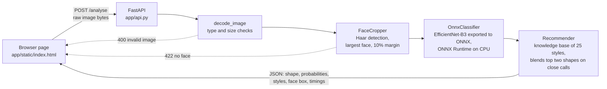
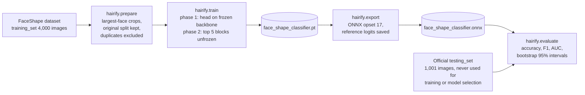

# Architecture

## Request path (serving)

| Stage | Module | Failure handling |
|---|---|---|
| Upload | `app/api.py` | Content type must be an image (415); body at most 10 MB (413); `top_n` 1–5 (422) |
| Decode | `hairify/face.py::decode_image` | Unreadable or tiny/huge images raise `InvalidImageError` → 400 |
| Face crop | `hairify/face.py::FaceCropper` | No face raises `NoFaceError` → 422; several faces → the largest one |
| Classify | `hairify/onnx_backend.py::OnnxClassifier` (or `hairify/model.py::Classifier` for a `.pt` file) | Model loaded once at the first request; missing model → 503 |
| Recommend | `hairify/recommend.py` | Unknown shape raises an error instead of silently defaulting |

## Training and evaluation path

## Design decisions

- **The largest detection is the face.** OpenCV's Haar detector returns boxes in no order; the original notebook used the first one and sometimes cropped necks or background. 13% of test images and 12.5% of training images had several detections.
- **Haar instead of RetinaFace.** RetinaFace was the intended first choice, but it depends on TensorFlow, which was never installed, so every image used Haar. Serving uses the same detector as training so that the crops match.
- **The image travels as the raw request body**, not a multipart form, which avoids an extra dependency and makes the API easy to call with `curl --data-binary`.
- **Uncertainty is shown, not hidden.** When the top two shapes are within 15 points, the response sets `close_call` and adds styles for the second shape.
- **Weights are loaded lazily and are not in the image**, so the container stays small and the model can be swapped without rebuilding.
- **ONNX Runtime for serving, PyTorch for training.** On the CPU, ONNX Runtime runs one image in 12 ms against 34 ms for PyTorch, and the serving image drops from 10.7 GB (CUDA PyTorch) to 941 MB. The export is verified against saved PyTorch logits.
- **OpenCV is pinned to the training version** (4.13.0.92) in the serving requirements, so face crops in production are produced by the same code that produced the training crops.
- **Backends share one interface** (`predict_proba(list of crops) -> (N, 5)`), so the pipeline and API do not know which one they use; tests run the serving path without PyTorch and the training path without ONNX Runtime.
